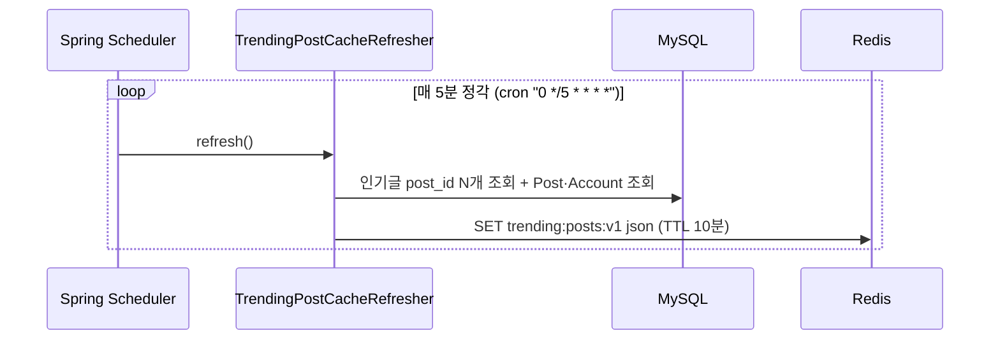
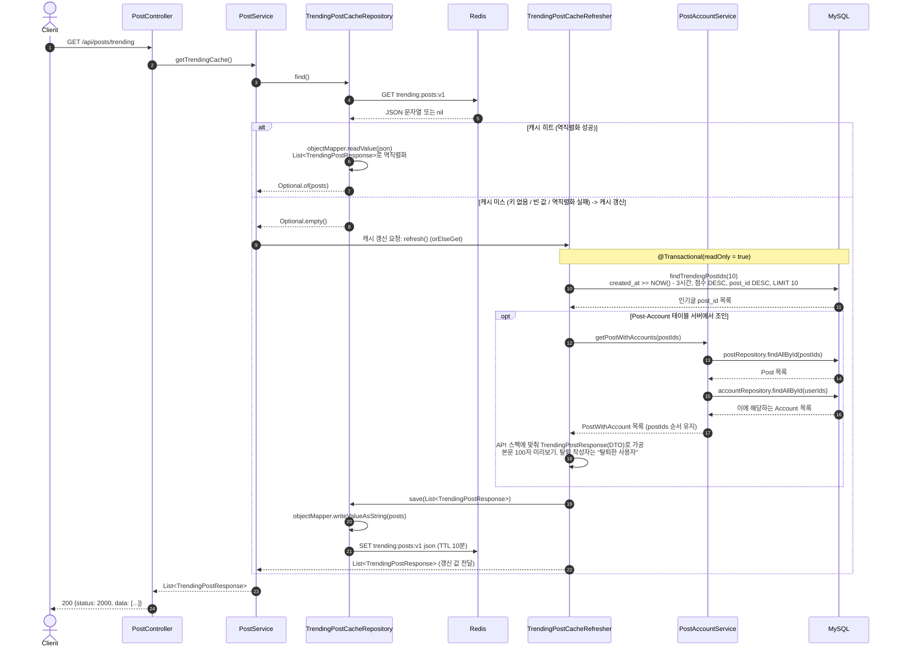
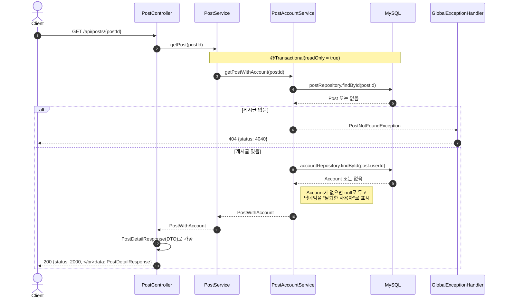
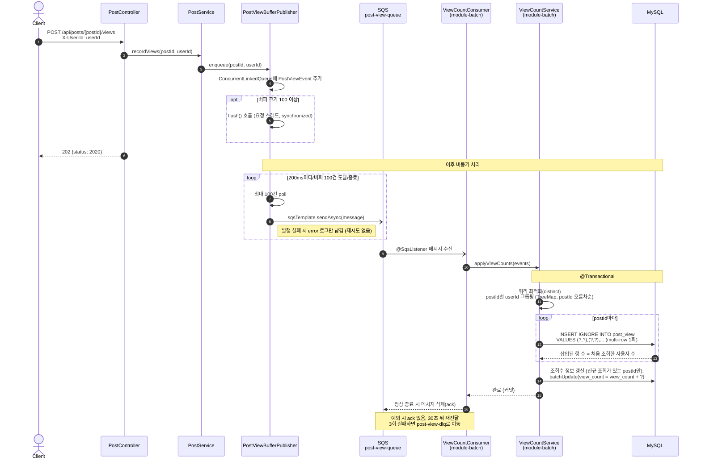
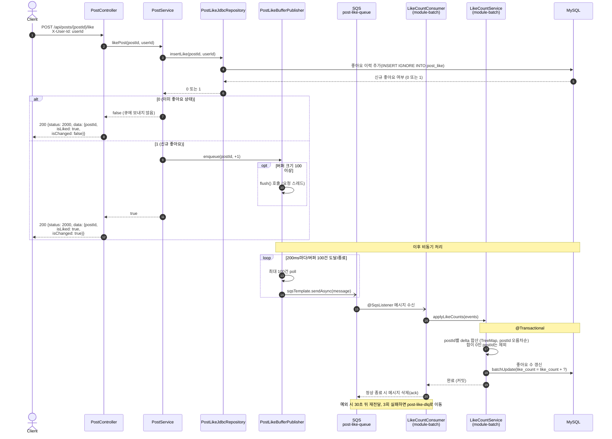
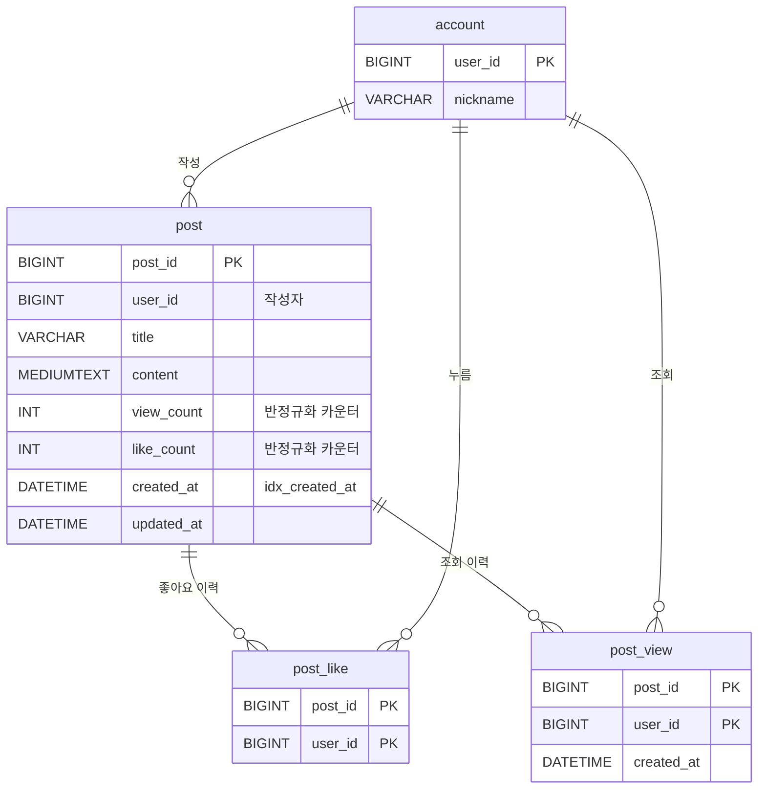

# 인기글 서비스

인기글 서비스는 아래 기준에 해당하는 상위 N개의 사용자 게시글을 보여준다.

인기글 선정 기준은 아래와 같다.

- **인기글 선정 기준**
    - `1.0 * 좋아요 수 + 0.05 * 조회 수 + 0.002 * 글자 수 - 1.0 * (현재 시각 - 작성 시각)`
    - 인기글은 **최근 3시간 내 작성된 게시글**에서 선정한다.
    - 한 번 인기글이 되면 5분 정도는 유지되어도 무방하다.

해당 커뮤니티에 게시글이 많아지고 많은 사용자들이 접속할 것을 가정한다.


# 1. 기술스택

Java 21, Spring Boot 4.1, MySQL, Redis, ElasticMQ, Docker


# 2. 서비스 규모 가정

- 하루 평균 방문자 수 (DAU) : 350만 명
    
- 하루 평균 게시글 생성량 : 100만 개
    
- 인기글 산정 기준 중 `현재 시각 - 작성 시각` 이 있는데 단위를 ‘분’으로 가정함.
    
    가장 오래된 게시글(3시간 전)의 시간감점의 경우
    
    if ‘**시간**’ : `현재 시각 - 작성 시각` = -3
    
    → 이는 3시간 동안 좋아요 3개/조회수 60개(0.05*60=3) 추가된다면 커버 가능하다는 의미.
    
    **시간 조건이 순위변동에 변별력을 주지 못함.**
    
    if ‘**분**’ : `현재 시각 - 작성 시각` = -180
    
    → 1분마다 1점씩 깎임. 1분마다 최소 좋아요 1개/조회수 20개(0.05*20=1)여야 커버 가능하다는 의미
    
    → **시간 조건이 순위변동에 변별력을 많이 줌.**


# 3. 모듈 구조
```
trending-service
├── module-core    # API ↔ Batch 간 메시지 스펙 (이벤트 DTO)
├── module-api     # REST API, 인기글 캐시, 이벤트 버퍼 & SQS 발행
└── module-batch   # SQS 소비, 조회수·좋아요 수 RDB 반영
```
- `module-api`와 `module-batch`는 서로를 의존하지 않고 `module-core`만 공유함. 

## 큐 메세지 스펙

| 클래스 | 필드 |
| --- | --- |
| `PostViewEvent` | `postId`, `userId` |
| `PostLikeEvent` | `postId`, `delta` (+1 / -1) |
| `PostViewBatchMessage` / `PostLikeBatchMessage` | `batchId`, `serverInstanceId`, `createdAt`, `events` |


# 4. 주요 API 시퀀스 다이어그램

> 부하 테스트와 성능 튜닝에 집중하기 위해, 인증은 구현하지 않고, X-User-Id 헤더로 사용자를 식별하게 함.

## 인기글 목록 조회 API

### 스케줄러: 5분마다 미리 갱신



### 요청 처리



- **5분 주기 갱신**: "한 번 인기글이 되면 5분 정도는 유지되어도 무방" 요구사항을 수행하기 위해, 매 요청마다 계산하지 않고 5분에 1번만 계산하게 함. 캐시 비어 있을 때만 요청 시점에 갱신함.
- **TTL 10분**: 스케줄러 주기(5분)보다 길게 잡아, 갱신 직전에 키가 만료되어 캐시 비는 구간 제거.
- **완성된 응답 캐싱**: 엔티티가 아니라 최종 응답 DTO 목록을 JSON 문자열로 직렬화해 저장함. 조회 시 DB 접근 없이 역직렬화만 하고 바로 응답함.
- **버전이 붙은 캐시 키** (`trending:posts:v1`): 응답 스펙이 바뀌면 키 버전을 올려 이전 형식의 캐시와 섞이지 않게 함.
- **애플리케이션으로 테이블 조인**: 점수 쿼리는 `post_id`만 반환하고, 게시글과 작성자는 각각 `findAllById`(IN 쿼리)로 가져와 서버에서 조인함. 작성자가 탈퇴한 경우 닉네임을 "탈퇴한 사용자"로 표시함.

## 게시글 상세 조회 API



## API 서버: 이벤트 버퍼
> `PostViewBufferPublisher`와 `PostLikeBufferPublisher`는 같은 구조.

- 조회수 업데이트 요청은 이벤트를 ConcurrentLinkedQueue에 넣고 바로 202로 응답함.
- 좋아요·좋아요 취소 요청은 post_like 이력을 DB에 먼저 반영하고, 실제로 변경된 경우에만 +1 / -1 이벤트를 큐에 넣음.
- **100건이 쌓이거나 200ms가 지나면** (`@Scheduled(fixedDelay = 200)`) 최대 100건을 꺼내 하나의 배치 메시지로 묶어 `SqsTemplate.sendAsync`로 발행함. SQS 전송은 sendAsync로 비동기 처리함.
- 서버가 정상 종료될 때는 `@PreDestroy`에서 남은 이벤트를 마저 발행하게 함.
- 메시지에 `batchId`, 발행한 서버의 `serverInstanceId`, 생성 시각을 담아 장애 추적에 사용되게 함.

## 게시글 조회수 업데이트 API


- **조회수 중복 집계 방지**: "하나의 포스트 조회수는 사용자당 평생 1회" 정책을 임의로 설정함. `post_view`의 PK가 `(post_id, user_id)`인 점을 이용하여 `INSERT IGNORE`하면, 실제 삽입한 행 수 = 새로 늘어날 조회수가 됨. 따라서 같은 메시지를 다시 받아도 이미 `post_view`에 이미 행이 있음이 확인되어 조회수가 중복 집계되지 않음.
- **쿼리 최적화**: 같은 게시글의 조회 이력은 사용자마다 INSERT하지 않고, postId별로 multi-row INSERT 1회로 묶음. 새로고침 등으로 생긴 중복 이벤트는 distinct로 먼저 제거함.
- **데드락 방지**: 한 메시지에 여러 게시글의 이벤트가 섞여 있고 컨슈머가 동시에 여러 개 돌 수 있음. 이로 인해 생기는 데드락 방지를 위해 `TreeMap`으로 `postId` 오름차순으로 정렬하여 모든 컨슈머가 같은 순서로 락을 잡게함.


## 게시글 좋아요 API


- **이력은 동기, 카운트는 비동기**: 좋아요 중복 집계 방지를 위해 요청 시점에 `post_like` 이력을 바로 DB에 씀. 부하가 큰 `post.like_count` UPDATE 쿼리만 SQS로 넘김.
- **쿼리 최적화**: 한 배치 안에서 눌렀다 취소해 delta 합이 0이 된 게시글은 UPDATE 쿼리 생략
- **데드락 방지**: 조회수 업데이트 API와 마찬가지로 `postId` 오름차순으로 처리해 데드락을 방지함.


### 커넥션 풀 분리

| 서버 | HikariCP 최대 / 최소 유휴 | 비고 |
| --- | --- | --- |
| module-api | 30 / 10 | OSIV 비활성화로 트랜잭션이 끝나면 커넥션을 바로 반환 |
| module-batch | 10 / 5 | 카운터 쓰기 부하가 API 서버 커넥션 풀에 영향을 주지 않음 |

# 5. 데이터 모델



- **반정규화**: 조회 성능을 위해 `post.view_count`, `post.like_count`를 둠
- **SSOT**: `post_view`, `post_like` 이력 테이블로 중복 집계 방지
- 테이블 간 관계는 **논리적 관계로만** 두고, **FK 제약은 걸지 않음.**
    - **핫스팍 락 경합 방지**: 이력 테이블 INSERT마다 같은 post 행에 S Lock이 잡힘. 동시에 배치 서버는 같은 행에 like_count UPDATE로 배타 락(X Lock)을 잡으려 하므로, 대기와 데드락이 늘어남.
    - 정합성을 DB 대신 애플리케이션이 책임지게 함. 애플리케이션에 문제가 생겨 정합성이 깨지더라도 SSOT가 있으므로 문제없음.
